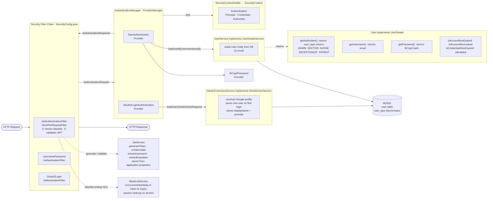

# Hospital Health Management System — Module IV

Spring Boot REST + GraphQL API secured with **Spring Security**, **JWT authentication**, **Google OAuth2**, and **Role-Based Access Control (RBAC)**.

Module IV adds a complete security layer on top of the Module III persistence backend: stateless JWT for the REST API, session-based OAuth2 for browser login, and fine-grained `@PreAuthorize` guards on every endpoint.

---

## Prerequisites

| Tool | Version |
|---|---|
| Java JDK | 21+ |
| Apache Maven | 3.6+ |
| MySQL Server | 8.0+ |
| IntelliJ IDEA | 2024+ (recommended) |

---

## Quick Start

### 1. Database setup

```sql
CREATE DATABASE hhm2;
```

Hibernate creates and updates the schema automatically on startup (`ddl-auto=update`).

### 2. Configure credentials

Edit `src/main/resources/application-dev.properties`:

```properties
spring.datasource.username=your_username
spring.datasource.password=your_password
spring.security.jwt.secret=your_base64_encoded_secret
spring.security.oauth2.client.registration.google.client-id=your_client_id
spring.security.oauth2.client.registration.google.client-secret=your_client_secret
```

### 3. Run the application

```bash
mvn spring-boot:run -Dspring-boot.run.profiles=dev
```

Server starts on **http://localhost:8080**.

### 4. API documentation

- **Swagger UI (REST):** http://localhost:8080/swagger-ui.html
- **GraphiQL (GraphQL):** http://localhost:8080/graphiql

---

## Spring Security Architecture

The diagram below shows how every request is authenticated in this application — from the incoming HTTP request through the filter chain, authentication manager, providers, and finally into the security context.



### How the two flows map to the diagram

| Flow | Filter triggered | Provider used | User loaded by |
|---|---|---|---|
| `POST /api/v1/auth/login` (JWT) | `UsernamePasswordAuthenticationFilter` | `DaoAuthenticationProvider` | `UserService.loadUserByUsername` |
| Google OAuth2 (browser) | `OAuth2LoginAuthenticationFilter` | `OAuth2LoginAuthenticationProvider` | `OAuth2UserSaveService.loadUser` |
| Subsequent JWT requests | `JwtAuthenticationFilter` | _(skips manager — sets context directly)_ | `UserService.loadUserByUsername` |

---

## Authentication

The system supports two separate authentication flows that coexist in the same application.

### Flow 1 — JWT (REST API clients: Postman, JavaFX, mobile)

```
POST /api/v1/auth/login
Content-Type: application/json

{ "email": "admin@hhm.com", "password": "secret" }
```

Response:

```json
{ "token": "eyJhbGc...", "expiresIn": 36000 }
```

Use the token on every subsequent request:

```
Authorization: Bearer eyJhbGc...
```

**Token structure (decoded):**

| Claim | Value |
|---|---|
| `sub` | user email |
| `iat` | issued-at timestamp |
| `exp` | expiry timestamp (10 hours) |

**Logout (blacklists the token):**

```
POST /api/v1/auth/logout
Authorization: Bearer eyJhbGc...
```

After logout the same token is rejected with **401** on all subsequent requests.

---

### Flow 2 — Google OAuth2 (browser)

1. Open **http://localhost:8080/login**
2. Click **"Login with Google"**
3. Complete Google consent — you are redirected to **http://localhost:8080/dashboard**
4. First-time users are saved with no role (pending). An admin must assign a role before they can access protected endpoints.
5. Logout via the button on the dashboard — this invalidates the HTTP session.

---

## Registration

```
POST /api/v1/auth/register
Content-Type: application/json
```

```json
{
  "name": "Dr. Alice",
  "email": "alice@hhm.com",
  "password": "secret",
  "type": "DOCTOR",
  "licenseNumber": "LIC-2024-001",
  "departmentId": 1
}
```

| Field | Required for |
|---|---|
| `name`, `email`, `password`, `type` | All roles |
| `licenseNumber` | DOCTOR |
| `departmentId` | DOCTOR (optional) |
| `phone` | PATIENT |

---

## Roles

| Role | Discriminator value | Description |
|---|---|---|
| `ADMIN` | `ADMIN` | Full system access |
| `DOCTOR` | `DOCTOR` | Clinical staff |
| `NURSE` | `NURSE` | Nursing staff |
| `RECEPTIONIST` | `RECEPTIONIST` | Front desk |
| `PATIENT` | `PATIENT` | End user |

Roles are stored in the `user_type` discriminator column of the `user` table using JPA JOINED inheritance. `getAuthorities()` reads directly from that column — no separate roles table.

---

## Role-Based Access Control (RBAC)

Every endpoint is guarded with `@PreAuthorize`. Use `hasAuthority('ROLE')` — not `hasRole()` — because the discriminator values are stored without the `ROLE_` prefix.

| Endpoint | Allowed roles |
|---|---|
| `POST /api/v1/doctors` | ADMIN |
| `PUT /api/v1/doctors/{id}` | ADMIN or the owning DOCTOR |
| `DELETE /api/v1/doctors/{id}` | ADMIN |
| `POST /api/v1/patients` | ADMIN |
| `PUT /api/v1/patients/{id}` | ADMIN or the owning PATIENT |
| `DELETE /api/v1/patients/{id}` | ADMIN |
| `POST /api/v1/appointments` | PATIENT, RECEPTIONIST |
| `PATCH /api/v1/appointments/{id}/cancel` | ADMIN, RECEPTIONIST |
| `DELETE /api/v1/appointments/{id}` | ADMIN |
| `POST /api/v1/feedback` | PATIENT, RECEPTIONIST |
| `GET /api/v1/admin/**` | ADMIN |

Owner-only example — only the doctor with matching `id` can update their own record:

```java
@PreAuthorize("hasAuthority('ADMIN') or (hasAuthority('DOCTOR') and authentication.principal.id == #id)")
```

---

## Google OAuth2 — Pending User Management

New Google users are saved as base `User` rows with no `user_type` discriminator. An admin must assign a role before they can call protected endpoints.

**List pending users:**

```
GET /api/v1/admin/users/pending
Authorization: Bearer <admin-token>
```

**Assign a role:**

```
PUT /api/v1/admin/users/{id}/role
Authorization: Bearer <admin-token>
Content-Type: application/json
```

```json
{ "role": "PATIENT", "phone": "0788000001" }
```

```json
{ "role": "DOCTOR", "licenseNumber": "LIC-2024-002", "departmentId": 2 }
```

```json
{ "role": "NURSE" }
```

The endpoint deletes the pending base `User` row and creates the proper subclass record (Patient/Doctor/etc.) using the `display_name` from Google as the name.

---

## CORS and CSRF

### CORS (Cross-Origin Resource Sharing)

CORS is a **browser** restriction. When JavaScript at `http://frontend.com` calls `http://localhost:8080`, the browser first sends an `OPTIONS` preflight request. The server must respond with the correct `Access-Control-Allow-*` headers or the browser blocks the response.

**Current configuration** (`SecurityConfig.corsConfigurationSource`):

```
Allowed origins:  * (all — dev only; restrict to your domain in production)
Allowed methods:  GET, POST, PUT, PATCH, DELETE, OPTIONS
Allowed headers:  Authorization, Content-Type, Accept
Exposed headers:  Authorization
Max age:          3600s (preflight cached for 1 hour)
```

**Production change:** replace `setAllowedOriginPatterns(List.of("*"))` with your frontend domain:

```java
config.setAllowedOriginPatterns(List.of("https://your-frontend.com"));
```

CORS does **not** apply to Postman, curl, or JavaFX — only browsers enforce it.

### CSRF (Cross-Site Request Forgery)

CSRF is disabled in this application because the REST API is **stateless** — it uses JWT Bearer tokens, which browsers do not automatically attach to cross-origin requests (unlike cookies). There is therefore no CSRF attack surface for the API.

The OAuth2 web logout form uses `method="post"`, which Spring Security validates internally — this is safe even with CSRF disabled because the logout session is managed server-side.

| | CORS | CSRF |
|---|---|---|
| **Protects against** | Unauthorized cross-origin reads | Forged state-changing requests |
| **Enforced by** | Browser | Server |
| **Needed here** | Yes — browsers block API calls without it | No — stateless JWT has no CSRF attack surface |
| **Disabled by** | Cannot be disabled in browser | `AbstractHttpConfigurer::disable` |

---

## JWT Implementation Details

| Aspect | Detail |
|---|---|
| Library | `io.jsonwebtoken:jjwt` 0.12.x |
| Signing algorithm | HMAC-SHA256 (`HS256`) |
| Secret storage | `${spring.security.jwt.secret}` in properties |
| Token expiry | 10 hours |
| Filter | `JwtAuthenticationFilter` — `OncePerRequestFilter` before `UsernamePasswordAuthenticationFilter` |
| Blacklist | `BlackListService` — `ConcurrentHashMap<token, expiry>` |
| Blacklist cleanup | Passive — expired entries removed on first access after expiry |

**Token validation flow per request:**

```
Request arrives → JwtAuthenticationFilter
  → Is token in blacklist?         → Yes → pass through unauthenticated (401)
  → Extract email from claims      → Fail (tampered/expired) → 401
  → Load UserDetails from DB
  → isTokenValid(token, user)?     → No → pass through unauthenticated (401)
  → Set SecurityContext
  → Proceed to controller
```

---

## DSA in Security

| Concept | Implementation |
|---|---|
| **Hashing** | BCrypt for passwords (`BCryptPasswordEncoder`, cost factor 10) |
| **HMAC signing** | HMAC-SHA256 for JWT signatures — keyed hash prevents forgery |
| **HashMap lookup** | `ConcurrentHashMap` in `BlackListService` — O(1) token revocation check |
| **In-memory cache** | `AppCache` — static `HashMap<Class, List>` for entity caching |
| **Spring Cache** | `@Cacheable` / `@CacheEvict` on all service read/write methods |

**BCrypt vs plain hashing:**
BCrypt is a deliberately slow adaptive function. Unlike SHA-256 (fast, deterministic), BCrypt incorporates a random salt and a cost factor, making brute-force and rainbow table attacks impractical even if the hash database is stolen.

**Why `ConcurrentHashMap` for the blacklist:**
JWT validation happens on every request. Under concurrent load, a plain `HashMap` would have race conditions on `put` and `get`. `ConcurrentHashMap` provides lock-free reads and segment-locked writes, keeping the O(1) lookup while being thread-safe.

---

## Security Event Logging

All controller and service activity is captured by `LoggingAop`:

| Advice | Trigger | Level |
|---|---|---|
| `@Before` controller | Method called — logs name + args | INFO |
| `@AfterReturning` controller | Successful return — logs response | INFO |
| `@AfterThrowing` controller | Exception escaped — logs message | ERROR |
| `@Around` controller | Measures elapsed time in ms | INFO |
| `@Before` service | Service method called — logs class + method + args | DEBUG |
| `@AfterReturning` service | Service returned — logs result | DEBUG |
| `@AfterThrowing` service | Business rule violation — logs message | WARN |

**Log output example:**

```
[CTRL] --> login | args: [LoginRequest(email=admin@hhm.com)]
[SVC]  --> AuthService.createUser | args: [RegisterRequest(...)]
[SVC]  OK  createUser | returned: User(id=5, email=admin@hhm.com)
[CTRL] OK  login | returned: LoginResponse(token=eyJhbGc...)
[CTRL] TIME login completed in 312 ms
[CTRL] <-- login | exited (success or error)
```

Authentication failures (wrong password, expired token) produce ERROR-level output via the `@AfterThrowing` controller advice.

---

## Testing with Postman

### 1. Login with the seeded admin account

The `DataSeeder` creates an admin on first boot — no manual registration needed.

```
POST http://localhost:8080/api/v1/auth/login
Content-Type: application/json

{ "email": "admin@hhm.rw", "password": "admin123" }
```

### 2. Register a patient (the only self-registration allowed)

```
POST http://localhost:8080/api/v1/auth/register
Content-Type: application/json

{ "name": "Jane Doe", "email": "jane@example.com", "password": "secret", "type": "PATIENT", "phone": "0788000001" }
```

> `type: ADMIN / DOCTOR / NURSE / RECEPTIONIST` → **403 Forbidden**.
> Staff accounts are created by an authenticated admin via `POST /api/v1/admin` endpoints.

### 3. Copy the token from the login response

Copy the `token` value from the response.

### 3. Call a protected endpoint

In Postman, go to the **Authorization** tab → select **Bearer Token** → paste the token.

```
GET http://localhost:8080/api/v1/admin/users
Authorization: Bearer eyJhbGc...
```

### 4. Verify token rejection

- Call any protected endpoint with no token → **401 Unauthorized**
- Modify the token's payload → **401 Unauthorized** (signature mismatch)
- Logout, then reuse the same token → **401 Unauthorized** (blacklisted)

### 5. Verify RBAC

```
GET http://localhost:8080/api/v1/admin/users
Authorization: Bearer <patient-token>   → 403 Forbidden

POST http://localhost:8080/api/v1/appointments
Authorization: Bearer <doctor-token>    → 403 Forbidden
```

---

## GraphQL API — Demo Queries & Mutations

Open **http://localhost:8080/graphiql**, paste a JWT token in the top bar, and copy-paste any operation below.

---

### Auth

#### Login (get a JWT token)
```graphql
mutation {
  login(input: {
    email: "admin@hhm.rw"
    password: "admin123"
  }) {
    token
    expiresIn
  }
}
```

#### Register a new patient account (public)
```graphql
mutation {
  register(input: {
    name: "Jane Doe"
    email: "jane@example.com"
    password: "secret123"
  }) {
    id
    email
    userType
  }
}
```

#### Who am I? _(requires token)_
```graphql
query {
  me {
    id
    email
    userType
    displayName
    provider
  }
}
```

#### Logout — blacklists the current token _(requires token)_
```graphql
mutation {
  logout
}
```

---

### Admin — user management _(ADMIN token required)_

#### List all system users
```graphql
query {
  users {
    id
    email
    userType
    name
    displayName
    provider
  }
}
```

#### List all admins
```graphql
query {
  admins {
    id
    email
    name
  }
}
```

#### List pending Google users (no role assigned yet)
```graphql
query {
  pendingUsers {
    id
    email
    displayName
    provider
  }
}
```

#### Create a new admin account
```graphql
mutation {
  createAdmin(input: {
    name: "New Admin"
    email: "admin2@hhm.rw"
    password: "admin123"
  })
}
```

#### Assign a role to a pending Google user
```graphql
mutation {
  assignRole(id: 5, input: {
    role: "PATIENT"
    phone: "0788000001"
  }) {
    id
    email
    userType
  }
}
```

```graphql
mutation {
  assignRole(id: 6, input: {
    role: "DOCTOR"
    licenseNumber: "LIC-2025-001"
    departmentId: "1"
  }) {
    id
    email
    userType
  }
}
```

#### Delete a user
```graphql
mutation {
  deleteUser(id: 10)
}
```

---

### Patients _(ADMIN token required for mutations)_

#### List all patients
```graphql
query {
  patients {
    id
    name
    email
    phone
  }
}
```

#### Search patients by name
```graphql
query {
  patients(search: "Alain") {
    id
    name
    phone
    email
  }
}
```

#### Paginated patient list
```graphql
query {
  patientsPaged(page: 0, size: 10) {
    content {
      id
      name
      email
    }
    totalElements
    totalPages
    pageNumber
    pageSize
  }
}
```

#### Get single patient
```graphql
query {
  patient(id: 1) {
    id
    name
    phone
    email
    address
  }
}
```

#### Register a patient
```graphql
mutation {
  registerPatient(input: {
    name: "Alain Habimana"
    phone: "0788111222"
    email: "alain@example.com"
    address: "KG 123 St"
    district: "Gasabo"
    sector: "Remera"
    cell: "Cell 1"
    village: "Village 2"
  })
}
```

#### Delete a patient
```graphql
mutation {
  deletePatient(id: 1)
}
```

---

### Doctors _(ADMIN token required for mutations)_

#### List all doctors
```graphql
query {
  doctors {
    id
    name
    licenseNumber
    departmentId
  }
}
```

#### Search doctors
```graphql
query {
  doctors(search: "Emmanuel") {
    id
    name
    licenseNumber
  }
}
```

#### Get single doctor
```graphql
query {
  doctor(id: 1) {
    id
    name
    licenseNumber
    departmentId
  }
}
```

#### Register a doctor
```graphql
mutation {
  registerDoctor(input: {
    name: "Dr. Alice Uwimana"
    departmentId: "1"
    licenseNumber: "LIC-2025-010"
  })
}
```

#### Delete a doctor
```graphql
mutation {
  deleteDoctor(id: 1)
}
```

---

### Departments _(ADMIN token required for mutations)_

#### List all departments
```graphql
query {
  departments {
    id
    name
  }
}
```

#### Create a department
```graphql
mutation {
  createDepartment(name: "Ophthalmology")
}
```

#### Delete a department
```graphql
mutation {
  deleteDepartment(id: 11)
}
```

---

### Appointments _(PATIENT or RECEPTIONIST to book; ADMIN or RECEPTIONIST to cancel)_

#### List all appointments
```graphql
query {
  appointments {
    id
    patientName
    doctorName
    departmentName
    appointmentDate
    status
  }
}
```

#### Filter by status
```graphql
query {
  appointments(status: "Scheduled") {
    id
    patientName
    doctorName
    appointmentDate
  }
}
```

#### Search appointments
```graphql
query {
  appointments(search: "Habimana") {
    id
    patientName
    doctorName
    status
  }
}
```

#### Book an appointment _(PATIENT or RECEPTIONIST token)_
```graphql
mutation {
  bookAppointment(input: {
    patientId: "1"
    doctorId: "2"
    appointmentDate: "2026-11-20T10:00:00"
  })
}
```

#### Cancel an appointment _(ADMIN or RECEPTIONIST token)_
```graphql
mutation {
  cancelAppointment(id: 1)
}
```

#### Delete an appointment _(ADMIN token)_
```graphql
mutation {
  deleteAppointment(id: 1)
}
```

---

### Prescriptions _(DOCTOR to issue; DOCTOR or ADMIN to cancel; ADMIN to delete)_

#### List all prescriptions
```graphql
query {
  prescriptions {
    id
    patientId
    doctorId
    issuedAt
    status
    notes
  }
}
```

#### Issue a prescription _(DOCTOR token)_
```graphql
mutation {
  issuePrescription(input: {
    patientId: "1"
    doctorId: "1"
    notes: "Take with food. Avoid alcohol."
  })
}
```

#### Cancel a prescription _(DOCTOR or ADMIN token)_
```graphql
mutation {
  cancelPrescription(id: 1)
}
```

#### Delete a prescription _(ADMIN token)_
```graphql
mutation {
  deletePrescription(id: 1)
}
```

---

### Feedback _(RECEPTIONIST or PATIENT to submit; ADMIN, NURSE, or RECEPTIONIST to delete)_

#### List all feedback
```graphql
query {
  feedback {
    id
    patientId
    feedback
    privateNotes
    issuedAt
  }
}
```

#### Search feedback
```graphql
query {
  feedback(search: "excellent") {
    id
    feedback
    issuedAt
  }
}
```

#### Submit feedback _(PATIENT or RECEPTIONIST token)_
```graphql
mutation {
  submitFeedback(input: {
    patientId: "1"
    feedback: "Excellent service, very professional staff."
    privateNotes: "Patient expressed high satisfaction."
  })
}
```

#### Delete feedback _(ADMIN, NURSE, or RECEPTIONIST token)_
```graphql
mutation {
  deleteFeedback(id: 1)
}
```

---

### Inventory _(low-stock and mutations require ADMIN, NURSE, or RECEPTIONIST)_

#### List all inventory items _(any authenticated user)_
```graphql
query {
  inventory {
    id
    name
    sku
    quantityOnHand
    reorderLevel
  }
}
```

#### Search inventory
```graphql
query {
  inventory(search: "Amoxicillin") {
    id
    name
    sku
    quantityOnHand
  }
}
```

#### Low-stock items _(ADMIN, NURSE, or RECEPTIONIST token)_
```graphql
query {
  lowStockItems {
    id
    name
    sku
    quantityOnHand
    reorderLevel
  }
}
```

#### Add an inventory item _(ADMIN, NURSE, or RECEPTIONIST token)_
```graphql
mutation {
  addInventoryItem(input: {
    name: "Paracetamol 1000mg"
    sku: "MED-PCM-1000"
    quantityOnHand: 500
    reorderLevel: 100
  })
}
```

#### Delete an inventory item _(ADMIN or RECEPTIONIST token)_
```graphql
mutation {
  deleteInventoryItem(id: 1)
}
```

---

### Seeded demo credentials

| Role | Email | Password |
|---|---|---|
| Admin | `admin@hhm.rw` | `admin123` |
| Doctor (1–10) | `doctor1@hhm.rw` | `doctor123` |
| Nurse (1–30) | `nurse1@hhm.rw` | `nurse123` |
| Patient (1–100) | `patient1@hhm.rw` | `patient123` |

> **Receptionist** is not seeded. Create one via:
> `POST /api/v1/admin` with admin token and `"type": "RECEPTIONIST"`.

---

## Spring Profiles

| Profile | File | DDL auto | Logging | SQL printed |
|---|---|---|---|---|
| `dev` (default) | `application-dev.properties` | `update` | DEBUG | Yes |
| `prod` | `application-prod.properties` | `validate` | INFO | No |

```bash
# Development
mvn spring-boot:run -Dspring-boot.run.profiles=dev

# Production
mvn spring-boot:run -Dspring-boot.run.profiles=prod
```

---

## Project Structure

```
src/main/java/com/hhm/
  aop/
    LoggingAop.java              @Aspect — controller + service logging (all 5 advice types)
  controller/
    AuthController.java          POST /auth/login, /auth/register, /auth/logout
    AdminController.java         Admin-only: users, pending, role assignment
    GoogleLoginController.java   GET /login, /dashboard (OAuth2 web flow)
    DoctorController.java
    PatientController.java
    AppointmentController.java
    FeedbackController.java
    PrescriptionController.java
    InventoryController.java
    GlobalExceptionHandler.java  @RestControllerAdvice — centralized error responses
  dto/
    AssignRoleRequest.java       role + phone / licenseNumber / departmentId
    RegisterRequest.java
    LoginRequest.java
    LoginResponse.java
    Type.java                    Enum: ADMIN, DOCTOR, NURSE, RECEPTIONIST, PATIENT
    ApiResult.java               Generic response envelope {status, message, data}
  model/
    User.java                    Base entity — JOINED inheritance, discriminator user_type
    Admin.java / Doctor.java / Nurse.java / Receptionist.java / Patient.java
  repository/
    UserRepository.java          findByEmail, findByUserTypeIsNull (pending OAuth2 users)
  service/
    AuthService.java             createUser, promoteOAuthUser
    JwtService.java              generate, validate, extract — secret from properties
    BlackListService.java        ConcurrentHashMap token revocation
    OAuth2UserSaveService.java   Persists Google users on first login
    UserFactory.java             switch-based user subclass builder
  util/
    SecurityConfig.java          FilterChain, CORS, OAuth2, logout
    JwtAuthenticationFilter.java OncePerRequestFilter — blacklist check + JWT validation
    AppCache.java                Static HashMap-based entity cache

src/test/java/com/hhm/
  controller/
    SecurityAccessControlTest.java  30+ MockMvc tests covering all role combinations
```

---

## Author

**MUGWANEZA MANZI Audace** — audace.manzi@amalitechtraining.org
