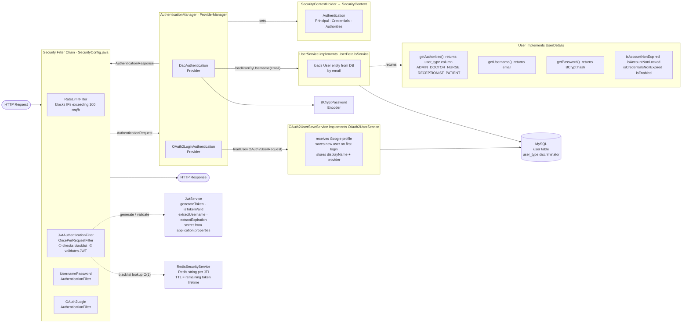

# Hospital Health Management System — Module IV

Spring Boot REST + GraphQL API secured with **Spring Security**, **JWT authentication**, **Google OAuth2**, and **Role-Based Access Control (RBAC)**.

Module IV adds a complete security layer on top of the Module III persistence backend: stateless JWT for the REST API, session-based OAuth2 for browser login, and fine-grained `@PreAuthorize` guards on every endpoint.

---

## Prerequisites

| Tool | Version |
|---|---|
| Java JDK | 21+ |
| Apache Maven | 3.6+ |
| MySQL Server | 8.0+ |
| Redis Server | 7.x+ |
| IntelliJ IDEA | 2024+ (recommended) |

---

## Quick Start

### 1. Database setup

```sql
CREATE DATABASE hhm2;
```

Hibernate creates and updates the schema automatically on startup (`ddl-auto=update`).

### 2. Configure credentials

Edit `src/main/resources/application-dev.properties`:

```properties
spring.datasource.username=your_username
spring.datasource.password=your_password
spring.security.jwt.secret=your_base64_encoded_secret
spring.security.oauth2.client.registration.google.client-id=your_client_id
spring.security.oauth2.client.registration.google.client-secret=your_client_secret
spring.data.redis.host=localhost
spring.data.redis.port=6379
```

### 3. Run the application

```bash
mvn spring-boot:run -Dspring-boot.run.profiles=dev
```

Server starts on **http://localhost:8080**.

### 4. API documentation

- **Swagger UI (REST):** http://localhost:8080/swagger-ui.html
- **GraphiQL (GraphQL):** http://localhost:8080/graphiql

---

## Spring Security Architecture

The diagram below shows how every request is authenticated — from the incoming HTTP request through the filter chain, authentication manager, providers, and into the security context.



### How the two flows map to the diagram

| Flow | Filter triggered | Provider used | User loaded by |
|---|---|---|---|
| `POST /api/v1/auth/login` (JWT) | `UsernamePasswordAuthenticationFilter` | `DaoAuthenticationProvider` | `UserService.loadUserByUsername` |
| Google OAuth2 (browser) | `OAuth2LoginAuthenticationFilter` | `OAuth2LoginAuthenticationProvider` | `OAuth2UserSaveService.loadUser` |
| Subsequent JWT requests | `JwtAuthenticationFilter` | _(skips manager — sets context directly)_ | `UserService.loadUserByUsername` |

---

## Authentication

The system supports two separate authentication flows that coexist in the same application.

### Flow 1 — JWT (REST API clients: Postman, JavaFX, mobile)

```
POST /api/v1/auth/login
Content-Type: application/json

{ "email": "admin@hhm.rw", "password": "admin123" }
```

Response:

```json
{ "token": "eyJhbGc...", "expiresIn": 36000 }
```

Use the token on every subsequent request:

```
Authorization: Bearer eyJhbGc...
```

**Token structure (decoded via `GET /api/v1/analysis?token=<token>`):**

```json
{
  "data": "{sub=admin@hhm.rw, jti=c2a63352-38ec-4f9f-842a-7af064400e11, iat=1793976613, exp=1794012613}",
  "message": "Token decoded successfully",
  "status": 200
}
```

| Claim | Value |
|---|---|
| `sub` | user email (the subject — identifies the user) |
| `jti` | unique token ID (used for blacklisting on logout) |
| `iat` | issued-at Unix timestamp |
| `exp` | expiry Unix timestamp (10 hours after issue) |

Roles are **not embedded in the token**. On each request, `JwtAuthenticationFilter` loads a fresh `UserDetails` from the database, so authorities are always current and cannot be forged by token manipulation.

**Logout (blacklists the token by JTI):**

```
POST /api/v1/auth/logout
Authorization: Bearer eyJhbGc...
```

After logout the same token is rejected with **401** on all subsequent requests.

---

### Flow 2 — Google OAuth2 (browser)

1. Open **http://localhost:8080/login**
2. Click **"Login with Google"**
3. Complete Google consent — you are redirected to **http://localhost:8080/dashboard**
4. First-time users are saved with no role (pending). An admin must assign a role before they can access protected endpoints.
5. Logout via the button on the dashboard — this invalidates the HTTP session.

---

## Registration

```
POST /api/v1/auth/register
Content-Type: application/json
```

```json
{
  "name": "Dr. Alice",
  "email": "alice@hhm.com",
  "password": "secret",
  "type": "DOCTOR",
  "licenseNumber": "LIC-2024-001",
  "departmentId": 1
}
```

| Field | Required for |
|---|---|
| `name`, `email`, `password`, `type` | All roles |
| `licenseNumber` | DOCTOR |
| `departmentId` | DOCTOR (optional) |
| `phone` | PATIENT |

> Public self-registration is restricted to `PATIENT` accounts. Any attempt to register as `ADMIN`, `DOCTOR`, `NURSE`, or `RECEPTIONIST` returns **403 Forbidden**. Staff accounts are created by an authenticated admin.

---

## Roles

| Role | Discriminator value | Description |
|---|---|---|
| `ADMIN` | `ADMIN` | Full system access |
| `DOCTOR` | `DOCTOR` | Clinical staff |
| `NURSE` | `NURSE` | Nursing staff |
| `RECEPTIONIST` | `RECEPTIONIST` | Front desk |
| `PATIENT` | `PATIENT` | End user |

Roles are stored in the `user_type` discriminator column of the `user` table using JPA JOINED inheritance. `getAuthorities()` reads directly from that column — no separate roles table.

---

## Role-Based Access Control (RBAC)

Every endpoint is guarded with `@PreAuthorize`. Use `hasAuthority('ROLE')` — not `hasRole()` — because discriminator values are stored without the `ROLE_` prefix.

| Endpoint | Allowed roles |
|---|---|
| `POST /api/v1/doctors` | ADMIN |
| `PUT /api/v1/doctors/{id}` | ADMIN or the owning DOCTOR |
| `DELETE /api/v1/doctors/{id}` | ADMIN |
| `POST /api/v1/patients` | RECEPTIONIST, NURSE |
| `POST /api/v1/patients/admit` | RECEPTIONIST, NURSE |
| `PUT /api/v1/patients/{id}` | ADMIN or the owning PATIENT |
| `DELETE /api/v1/patients/{id}` | ADMIN |
| `POST /api/v1/appointments` | PATIENT, RECEPTIONIST |
| `PUT /api/v1/appointments/{id}` | RECEPTIONIST, DOCTOR |
| `PATCH /api/v1/appointments/{id}/cancel` | ADMIN, RECEPTIONIST |
| `DELETE /api/v1/appointments/{id}` | ADMIN |
| `POST /api/v1/feedback` | PATIENT, RECEPTIONIST |
| `DELETE /api/v1/feedback/{id}` | ADMIN, NURSE, RECEPTIONIST |
| `GET /api/v1/admin/**` | ADMIN |
| `GET /api/v1/analysis/**` | ADMIN |

Owner-only example — only the doctor with the matching `id` can update their own record:

```java
@PreAuthorize("hasAuthority('ADMIN') or (hasAuthority('DOCTOR') and authentication.principal.id == #id)")
```

---

## Google OAuth2 — Pending User Management

New Google users are saved as base `User` rows with no `user_type` discriminator. An admin must assign a role before they can call protected endpoints.

**List pending users:**

```
GET /api/v1/admin/users/pending
Authorization: Bearer <admin-token>
```

**Assign a role:**

```
PUT /api/v1/admin/users/{id}/role
Authorization: Bearer <admin-token>
Content-Type: application/json
```

```json
{ "role": "PATIENT", "phone": "0788000001" }
```

```json
{ "role": "DOCTOR", "licenseNumber": "LIC-2024-002", "departmentId": 2 }
```

```json
{ "role": "NURSE" }
```

The endpoint deletes the pending base `User` row and creates the proper subclass record (Patient/Doctor/etc.) using the `display_name` from Google as the name.

---

## CORS and CSRF

### CORS (Cross-Origin Resource Sharing)

CORS is a **browser** restriction. When JavaScript at `http://localhost:3000` calls `http://localhost:8080`, the browser first sends an `OPTIONS` preflight request. The server must respond with the correct `Access-Control-Allow-*` headers or the browser blocks the response.

**Current configuration** (`SecurityConfig.corsConfigurationSource`):

```
Allowed origins:  http://localhost:3000  (React)
                  http://localhost:4200  (Angular)
                  http://localhost:5173  (Vite / Vue)
Allowed methods:  GET, POST, PUT, PATCH, DELETE, OPTIONS
Allowed headers:  Authorization, Content-Type, Accept
Exposed headers:  Authorization
Max age:          3600s (preflight cached for 1 hour)
```

A browser request from any other origin (e.g., `http://evil.com`) will not receive the `Access-Control-Allow-Origin` header and the browser will block the response.

**Production change:** replace the allowed origins with your deployed frontend domain:

```java
config.setAllowedOriginPatterns(List.of("https://your-frontend.com"));
```

CORS does **not** apply to Postman, curl, or JavaFX — only browsers enforce it.

**CORS demo endpoint (public):**

```
GET /api/v1/cors-demo
```

Returns the allowed origins list, the incoming `Origin` header value, and whether the request would be allowed or blocked. Call it from a browser dev console to observe the actual CORS headers.

### CSRF (Cross-Site Request Forgery)

CSRF is disabled in this application because the REST API is **stateless** — it uses JWT Bearer tokens, which browsers do not automatically attach to cross-origin requests (unlike cookies). There is therefore no CSRF attack surface for the API.

| | CORS | CSRF |
|---|---|---|
| **Protects against** | Unauthorized cross-origin reads | Forged state-changing requests |
| **Enforced by** | Browser | Server |
| **Needed here** | Yes — browsers block API calls without it | No — stateless JWT has no CSRF attack surface |

---

## JWT Implementation Details

| Aspect | Detail |
|---|---|
| Library | `io.jsonwebtoken:jjwt` 0.12.x |
| Signing algorithm | HMAC-SHA256 (`HS256`) |
| Secret storage | `${spring.security.jwt.secret}` in properties |
| Token expiry | 10 hours |
| Filter | `JwtAuthenticationFilter` — `OncePerRequestFilter` before `UsernamePasswordAuthenticationFilter` |
| Blacklist store | `RedisSecurityService` — Redis string per JTI, TTL = remaining token lifetime |

**Token validation flow per request:**

```
Request arrives → JwtAuthenticationFilter
  → Is JTI in Redis blacklist?         → Yes → pass through unauthenticated (401)
  → Extract email from claims          → Fail (tampered/expired) → 401
  → Load UserDetails from DB
  → isTokenValid(token, user)?         → No → 401
  → Set SecurityContext
  → Proceed to controller
```

---

## DSA in Security

| Concept | Implementation |
|---|---|
| **Hashing** | BCrypt for passwords (`BCryptPasswordEncoder`, cost factor 10) |
| **HMAC signing** | HMAC-SHA256 for JWT signatures — keyed hash prevents forgery |
| **Redis string lookup** | O(1) token revocation check — `RedisSecurityService.isTokenBlacklisted(jti)` |
| **Redis rate limiting** | Fixed-window counter per IP — `RedisSecurityService.isRateLimited(ip, max)` |
| **Spring Cache** | `@Cacheable` / `@CacheEvict` on service read/write methods |

**BCrypt vs plain hashing:**
BCrypt is a deliberately slow adaptive function. Unlike SHA-256 (fast, deterministic), BCrypt incorporates a random salt and a cost factor, making brute-force and rainbow table attacks impractical even if the hash database is stolen.

**Why Redis for the blacklist:**
JWT validation happens on every request. Redis provides sub-millisecond key lookup and native TTL support, so blacklisted JTIs expire automatically when the token would have expired anyway — no background cleanup job needed.

---

## Security Event Logging

### AOP-based request logging

All controller and service activity is captured by `LoggingAop`:

| Advice | Trigger | Level |
|---|---|---|
| `@Before` controller | Method called — logs name + args | INFO |
| `@AfterReturning` controller | Successful return — logs response | INFO |
| `@AfterThrowing` controller | Exception escaped — logs message | ERROR |
| `@Around` controller | Measures elapsed time in ms | INFO |
| `@Before` service | Service method called — logs class + method + args | DEBUG |
| `@AfterReturning` service | Service returned — logs result | DEBUG |
| `@AfterThrowing` service | Business rule violation — logs message | WARN |

**Log output example:**

```
[CTRL] --> login | args: [LoginRequest(email=admin@hhm.rw)]
[SVC]  --> AuthService.createUser | args: [RegisterRequest(...)]
[SVC]  OK  createUser | returned: User(id=5, email=admin@hhm.rw)
[CTRL] OK  login | returned: LoginResponse(token=eyJhbGc...)
[CTRL] TIME login completed in 312 ms
[CTRL] <-- login | exited (success or error)
```

Authentication failures (wrong password, expired token) produce ERROR-level output via the `@AfterThrowing` controller advice.

### Security report endpoint

A separate `SecurityTrackingAop` aspect increments Redis counters for every controller call. Login success and failure events are also recorded in `AuthController`. The consolidated report is accessible to admins:

```
GET /api/v1/analysis/report
Authorization: Bearer <admin-token>
```

**Example response:**

```json
{
  "status": 200,
  "message": "Security report",
  "data": {
    "loginSuccess": 42,
    "loginFailure": 7,
    "activeBlacklistedTokens": 3,
    "endpointFrequency": {
      "AuthController.login": 42,
      "PatientController.getAllPatients": 15,
      "AppointmentController.bookAppointment": 8
    }
  }
}
```

This report covers:
- **Login success / failure counts** — detect brute-force patterns
- **Active blacklisted tokens** — tokens revoked via logout but not yet expired
- **Endpoint access frequency** — which endpoints are being called and how often

---

## Testing with Postman

### 1. Login with the seeded admin account

```
POST http://localhost:8080/api/v1/auth/login
Content-Type: application/json

{ "email": "admin@hhm.rw", "password": "admin123" }
```

### 2. Register a patient (the only self-registration allowed)

```
POST http://localhost:8080/api/v1/auth/register
Content-Type: application/json

{ "name": "Jane Doe", "email": "jane@example.com", "password": "secret", "type": "PATIENT", "phone": "0788000001" }
```

> `type: ADMIN / DOCTOR / NURSE / RECEPTIONIST` → **403 Forbidden**.

### 3. Call a protected endpoint

In Postman, go to the **Authorization** tab → select **Bearer Token** → paste the token.

```
GET http://localhost:8080/api/v1/admin/users
Authorization: Bearer eyJhbGc...
```

### 4. Verify token rejection

- Call any protected endpoint with no token → **401 Unauthorized**
- Modify the token's payload → **401 Unauthorized** (signature mismatch)
- Logout, then reuse the same token → **401 Unauthorized** (JTI blacklisted in Redis)

### 5. Verify RBAC

```
GET  http://localhost:8080/api/v1/admin/users       Authorization: Bearer <patient-token>      → 403 Forbidden
POST http://localhost:8080/api/v1/appointments      Authorization: Bearer <doctor-token>       → 403 Forbidden
PUT  http://localhost:8080/api/v1/appointments/1    Authorization: Bearer <patient-token>      → 403 Forbidden
POST http://localhost:8080/api/v1/patients          Authorization: Bearer <doctor-token>       → 403 Forbidden
```

### 6. Decode a token (admin only)

```
GET http://localhost:8080/api/v1/analysis?token=eyJhbGc...
Authorization: Bearer <admin-token>
```

### 7. View the security report (admin only)

```
GET http://localhost:8080/api/v1/analysis/report
Authorization: Bearer <admin-token>
```

### 8. CORS demo

```
GET http://localhost:8080/api/v1/cors-demo
```

No token required. From Postman you will see `"corsResult": "N/A"` because Postman is not a browser. Open a browser console from `http://localhost:3000` and call the same URL with `fetch` to see the allowed-origin case.

---

## GraphQL API

Open **http://localhost:8080/graphiql**, paste a JWT token in the top bar, and copy-paste any operation below.

### Auth

```graphql
mutation {
  login(input: { email: "admin@hhm.rw", password: "admin123" }) {
    token
    expiresIn
  }
}
```

```graphql
mutation {
  register(input: { name: "Jane Doe", email: "jane@example.com", password: "secret123" }) {
    id
    email
    userType
  }
}
```

```graphql
query { me { id email userType displayName provider } }
```

```graphql
mutation { logout }
```

### Admin

```graphql
query { users { id email userType name displayName provider } }
query { pendingUsers { id email displayName provider } }
mutation { createAdmin(input: { name: "New Admin", email: "admin2@hhm.rw", password: "admin123" }) }
mutation { assignRole(id: 5, input: { role: "PATIENT", phone: "0788000001" }) { id email userType } }
mutation { deleteUser(id: 10) }
```

### Patients

```graphql
query { patients { id name email phone } }
query { patientsPaged(page: 0, size: 10) { content { id name email } totalElements totalPages } }
mutation {
  registerPatient(input: { name: "Alain Habimana", phone: "0788111222", email: "alain@example.com",
    district: "Gasabo", sector: "Remera", cell: "Cell 1", village: "Village 2" })
}
mutation { deletePatient(id: 1) }
```

### Doctors

```graphql
query { doctors { id name licenseNumber departmentId } }
mutation { registerDoctor(input: { name: "Dr. Alice", departmentId: "1", licenseNumber: "LIC-2025-010" }) }
mutation { deleteDoctor(id: 1) }
```

### Appointments

```graphql
query { appointments { id patientName doctorName appointmentDate status } }
mutation { bookAppointment(input: { patientId: "1", doctorId: "2", appointmentDate: "2026-11-20T10:00:00" }) }
mutation { cancelAppointment(id: 1) }
mutation { deleteAppointment(id: 1) }
```

### Prescriptions

```graphql
query { prescriptions { id patientId doctorId issuedAt status notes } }
mutation { issuePrescription(input: { patientId: "1", doctorId: "1", notes: "Take with food." }) }
mutation { cancelPrescription(id: 1) }
mutation { deletePrescription(id: 1) }
```

### Feedback

```graphql
query { feedback { id patientId feedback issuedAt } }
mutation { submitFeedback(input: { patientId: "1", feedback: "Excellent service.", privateNotes: "High satisfaction." }) }
mutation { deleteFeedback(id: 1) }
```

### Inventory

```graphql
query { inventory { id name sku quantityOnHand reorderLevel } }
query { lowStockItems { id name sku quantityOnHand reorderLevel } }
mutation { addInventoryItem(input: { name: "Paracetamol 1000mg", sku: "MED-PCM-1000", quantityOnHand: 500, reorderLevel: 100 }) }
mutation { deleteInventoryItem(id: 1) }
```

---

## Seeded demo credentials

| Role | Email | Password |
|---|---|---|
| Admin | `admin@hhm.rw` | `admin123` |
| Doctor (1–10) | `doctor1@hhm.rw` | `doctor123` |
| Nurse (1–30) | `nurse1@hhm.rw` | `nurse123` |
| Patient (1–100) | `patient1@hhm.rw` | `patient123` |

> **Receptionist** is not seeded. Create one via `POST /api/v1/admin` with an admin token and `"type": "RECEPTIONIST"`.

---

## Spring Profiles

| Profile | File | DDL auto | Logging | SQL printed |
|---|---|---|---|---|
| `dev` (default) | `application-dev.properties` | `update` | DEBUG | Yes |
| `prod` | `application-prod.properties` | `validate` | INFO | No |

```bash
mvn spring-boot:run -Dspring-boot.run.profiles=dev
```

---

## Project Structure

```
src/main/java/com/hhm/
  aop/
    LoggingAop.java               @Aspect — controller + service logging (all 5 advice types)
    SecurityTrackingAop.java      @Aspect — increments Redis endpoint-frequency counters
  controller/
    AuthController.java           POST /auth/login, /auth/register, /auth/logout
    AdminController.java          Admin-only: users, pending, role assignment
    GoogleLoginController.java    GET /login, /dashboard (OAuth2 web flow)
    CorsController.java           GET /cors-demo — public CORS demonstration endpoint
    AnalysisController.java       GET /analysis (token decode), GET /analysis/report (security report)
    DoctorController.java
    PatientController.java
    AppointmentController.java
    FeedbackController.java
    PrescriptionController.java
    InventoryController.java
    GlobalExceptionHandler.java   @RestControllerAdvice — centralized error responses
  dto/
    AssignRoleRequest.java        role + phone / licenseNumber / departmentId
    RegisterRequest.java
    LoginRequest.java
    LoginResponse.java
    Type.java                     Enum: ADMIN, DOCTOR, NURSE, RECEPTIONIST, PATIENT
    ApiResult.java                Generic response envelope {status, message, data}
  model/
    User.java                     Base entity — JOINED inheritance, discriminator user_type
    Admin.java / Doctor.java / Nurse.java / Receptionist.java / Patient.java
  repository/
    UserRepository.java           findByEmail, findByUserTypeIsNull (pending OAuth2 users)
  service/
    AuthService.java              createUser, promoteOAuthUser
    JwtService.java               generate, validate, extract — secret from properties
    RedisSecurityService.java     Redis token blacklist + IP rate limiting
    SecurityEventService.java     login event counters + endpoint frequency counters (Redis)
    OAuth2UserSaveService.java    persists Google users on first login
    UserFactory.java              switch-based user subclass builder
  util/
    SecurityConfig.java           FilterChain, CORS (restricted origins), OAuth2, logout
    JwtAuthenticationFilter.java  OncePerRequestFilter — blacklist check + JWT validation
    RateLimitFilter.java          OncePerRequestFilter — 100 req/h per IP, blocks for 24h
    RedisConfig.java              StringRedisTemplate bean

src/test/java/com/hhm/
  controller/
    SecurityAccessControlTest.java  MockMvc tests covering all role combinations
```

---

## Author

**MUGWANEZA MANZI Audace** — audace.manzi@amalitechtraining.org
