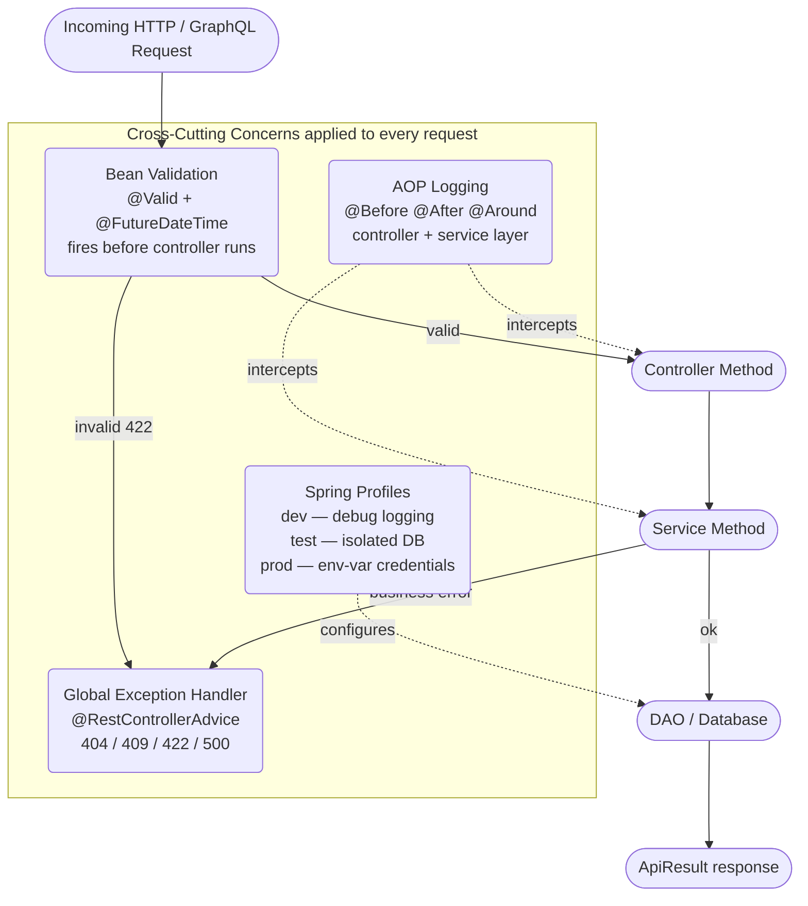

# HHM — Use Case Diagram

> **How to view:** Open in VS Code with the [Mermaid Preview](https://marketplace.visualstudio.com/items?itemName=bierner.markdown-mermaid) extension,
> or push to GitHub — Mermaid renders automatically in `.md` files.

---

## Actors

| Actor | Description |
|---|---|
| Administrator | Owns all records — registers/updates/deletes patients, doctors, and inventory |
| Receptionist | Handles patient flow — books, reschedules, and cancels appointments; records feedback |
| Doctor | Clinical work — issues, updates, and cancels prescriptions; views appointments |
| Frontend Developer | Consumes the GraphQL API for flexible, field-level data queries |

---

## System Use Case Diagram

```mermaid
flowchart LR
    %% ── Actors ────────────────────────────────────────────────────────────────
    Admin["Administrator"]
    Recep["Receptionist"]
    Doc["Doctor"]
    Dev["Frontend Developer"]

    %% ── System Boundary ───────────────────────────────────────────────────────
    subgraph SYS["Hospital Health Management System"]

        subgraph PAT["Patient Management"]
            p1("Register Patient")
            p2("Update Patient")
            p3("Delete Patient")
            p4("Search Patients")
            p5("Sort and Paginate")
        end

        subgraph DOC["Doctor Management"]
            d1("Register Doctor")
            d2("Update Doctor")
            d3("Delete Doctor")
            d4("Search Doctors")
        end

        subgraph APT["Appointment Management"]
            a1("Book Appointment")
            a2("Reschedule Appointment")
            a3("Cancel Appointment")
            a4("Filter by Status")
            a5("Sort and Paginate")
        end

        subgraph PRX["Prescription Management"]
            r1("Issue Prescription")
            r2("Update Prescription")
            r3("Cancel Prescription")
            r4("Delete Prescription")
        end

        subgraph INV["Inventory Management"]
            i1("Add Inventory Item")
            i2("Update Item")
            i3("Delete Item")
            i4("View Low-Stock Items")
        end

        subgraph FBK["Feedback Management"]
            f1("Submit Patient Feedback")
            f2("Search Feedback")
            f3("Delete Feedback")
        end

        subgraph GQL["GraphQL API"]
            g1("Query Patients and Doctors")
            g2("Query Appointments and Prescriptions")
            g3("Query Inventory and Feedback")
            g4("Mutate: Register / Book / Issue")
            g5("Mutate: Cancel / Delete")
        end

    end

    %% ── Administrator connections ─────────────────────────────────────────────
    Admin --> p1
    Admin --> p2
    Admin --> p3
    Admin --> p4
    Admin --> p5
    Admin --> d1
    Admin --> d2
    Admin --> d3
    Admin --> d4
    Admin --> i1
    Admin --> i2
    Admin --> i3
    Admin --> i4

    %% ── Receptionist connections ──────────────────────────────────────────────
    Recep --> p4
    Recep --> p5
    Recep --> a1
    Recep --> a2
    Recep --> a3
    Recep --> a4
    Recep --> a5
    Recep --> f1
    Recep --> f2
    Recep --> f3

    %% ── Doctor connections ────────────────────────────────────────────────────
    Doc --> r1
    Doc --> r2
    Doc --> r3
    Doc --> r4
    Doc --> a4
    Doc --> p4

    %% ── Frontend Developer connections ────────────────────────────────────────
    Dev --> g1
    Dev --> g2
    Dev --> g3
    Dev --> g4
    Dev --> g5
```

---

## Cross-Cutting Concerns

These apply to every use case automatically — no actor triggers them directly.

---

## Endpoint Map (Actor → URL)

| Actor | HTTP Method | Endpoint | Use Case |
|---|---|---|---|
| Administrator | POST | /api/v1/patients | Register Patient |
| Administrator | PUT | /api/v1/patients/{id} | Update Patient |
| Administrator | DELETE | /api/v1/patients/{id} | Delete Patient |
| Receptionist | GET | /api/v1/patients?search=&sort=&page=&size= | Search / Sort / Page |
| Administrator | POST | /api/v1/doctors | Register Doctor |
| Administrator | DELETE | /api/v1/doctors/{id} | Delete Doctor |
| Receptionist | POST | /api/v1/appointments | Book Appointment |
| Receptionist | PUT | /api/v1/appointments/{id} | Reschedule |
| Receptionist | PATCH | /api/v1/appointments/{id}/cancel | Cancel |
| Receptionist | GET | /api/v1/appointments?status=&sort=&page= | Filter / Sort / Page |
| Doctor | POST | /api/v1/prescriptions | Issue Prescription |
| Doctor | PATCH | /api/v1/prescriptions/{id}/cancel | Cancel Prescription |
| Administrator | POST | /api/v1/inventory | Add Item |
| Administrator | GET | /api/v1/inventory/low-stock | View Low-Stock |
| Receptionist | POST | /api/v1/feedback | Submit Feedback |
| Frontend Developer | POST | /graphql | All GraphQL queries and mutations |
| Any | GET | /swagger-ui.html | Browse REST API docs |
| Any | GET | /graphiql | Browse GraphQL schema + run queries |
